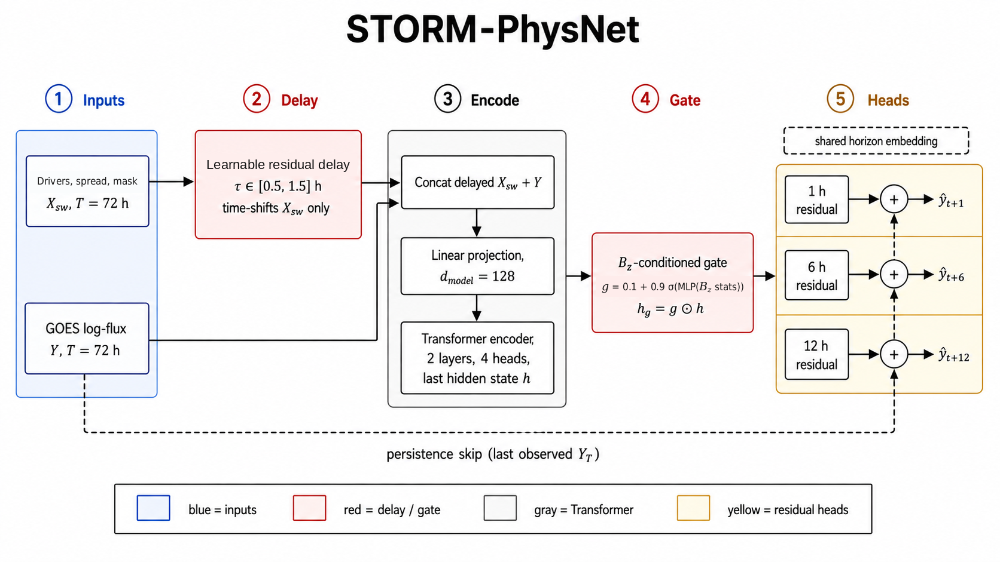
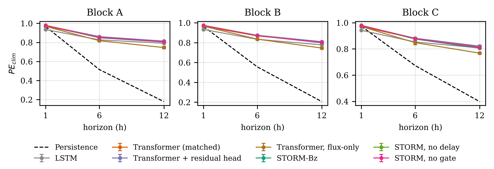
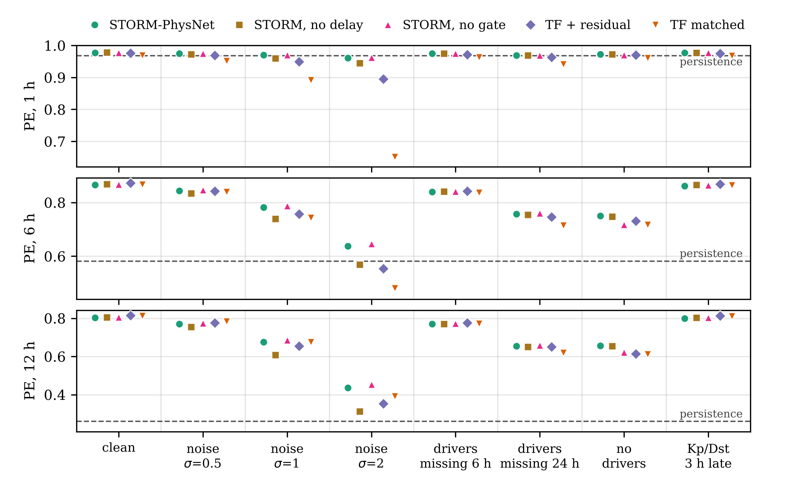
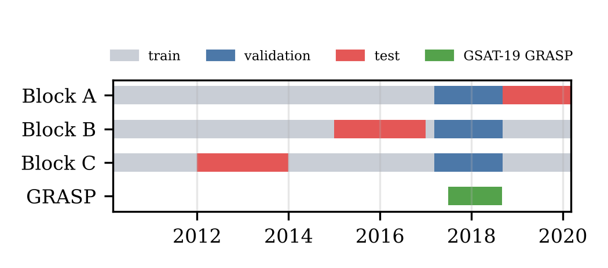

# STORM-PhysNet

**A multi-horizon Transformer that forecasts relativistic (>2 MeV) electron flux at geostationary orbit 1, 6 and 12 hours ahead, and transfers it to the Indian GSAT-19 GRASP sensor.**

Samarth B N, Samrudh S Malali, Dhyan M, Sanjana H V. RV College of Engineering, Bangalore.
IEEE AGERS 2026 (under review).

Electrons above 2 MeV at geostationary orbit charge spacecraft dielectrics and can damage onboard electronics. STORM-PhysNet predicts the GOES-15 >2 MeV log-flux from the past 72 h of flux and OMNI solar-wind and geomagnetic data. This repository has the full code, input data, every prediction, and every table and figure.

<p align="center"></p>

## Model

A Transformer encoder (d_model 128, 2 layers, 4 heads, d_ff 256; 344 k parameters) with three additions:

| Component | What it does |
|---|---|
| **Learnable delay stage** | A small network predicts τ ∈ [0.5, 1.5] h per window, and each input hour is replaced by a linear interpolation between hours t−⌊τ⌋ and t−⌊τ⌋+1 with weight τ−⌊τ⌋. As trained, τ sits at 1.5 h, which gives an equal-weight average of hours t−1 and t (a 0.5 h lag with two-point smoothing) |
| **Bz-conditioned gate** | Scales the encoder output by g = 0.1 + 0.9·sigmoid(MLP), fed the mean and max negative part of standardised Bz and the latest southward-Bz duration |
| **Residual heads** | Three heads (1, 6, 12 h) predict the change from the last observed flux rather than the flux itself |

Training uses a β-NLL loss with a 2.5× penalty on storm-time under-prediction, AdamW with cosine decay, and storm windows oversampled ×12. It stops early on the 12 h validation error.

## Results

PE is prediction efficiency relative to climatology (1 is perfect). Each value is the mean of 10 seeds, averaged over three separate test periods with 34,554 forecasts in total.

| Model | Params | PE 1 h | PE 6 h | PE 12 h | Skill vs persistence, 1 h |
|---|---:|---:|---:|---:|---:|
| Persistence | – | 0.968 | 0.581 | 0.261 | 0.00 |
| LSTM | 55 k | 0.937 | 0.838 | 0.792 | −0.97 |
| Transformer, matched in model dimension, depth and heads | 1.19 M | 0.969 | 0.867 | 0.813 | 0.04 |
| Transformer + residual head | 268 k | 0.976 | **0.872** | **0.815** | 0.25 |
| Transformer, flux-only | 1.19 M | 0.968 | 0.834 | 0.753 | 0.01 |
| **STORM-PhysNet** | 344 k | 0.977 | 0.865 | 0.803 | 0.29 |
| STORM-PhysNet, no delay | 344 k | **0.978** | 0.869 | 0.806 | **0.32** |
| STORM-PhysNet, no gate | 344 k | 0.977 | 0.867 | 0.805 | 0.28 |

**Key findings**
- **1 h.** STORM-PhysNet beats the matched Transformer in every test period. The gain is +0.008 PE (paired t-test, p = 3.5 × 10⁻¹⁸) and comes from the residual heads.
- **6–12 h.** All learned models are far above persistence, and the solar-wind inputs add +0.034 and +0.060 PE. STORM-PhysNet ties the matched Transformer at 6 h and trails it by 0.010 at 12 h.
- **Robustness to noisy drivers.** With unit-variance noise on the inputs, STORM-PhysNet keeps 1 h PE at **0.970**; the matched Transformer falls to 0.892. The delay stage is responsible: without it, PE drops by 0.010 / 0.043 / 0.067 at 1 / 6 / 12 h (Holm-corrected p < 10⁻⁹). Removing the gate changes nothing.
- **Missing drivers and index latency.** With no driver data at all, STORM-PhysNet keeps 12 h PE 0.656 (residual Transformer 0.614, matched 0.612), and here the gate helps (+0.034 at 12 h). Kp and Dst arriving 3 h late cost every model at most 0.004.
- **Transfer to GSAT-19 GRASP.** Without retraining, every persistence-anchored model transfers well (12 h PE 0.733–0.761; STORM-PhysNet 0.961 / 0.827 / 0.738 at 1 / 6 / 12 h). The matched Transformer gets 0.887 / 0.751 / 0.644. After fine-tuning all reach about 0.96 / 0.86 / 0.80.

<p align="center"><br>
<em>Change in PE relative to the matched Transformer. Bars are the mean over test periods; dots are the individual periods.</em></p>

<p align="center"></p>

<p align="center"><br>
<em>PE under driver corruptions: noise, outages, no drivers and late Kp/Dst (seed means averaged over test periods).</em></p>

## Evaluation protocol

<p align="center"></p>

| Test period | Forecasts | Storm forecasts (Dst ≤ −50 nT) | Lowest Dst |
|---|---:|---:|---:|
| A: Sep 2018 – Mar 2020 | 7,536 | 18 | −69 nT |
| B: Jan 2015 – Dec 2016 | 14,021 | 565 | −198 nT |
| C: Jan 2012 – Dec 2013 | 12,997 | 354 | −139 nT |

- **Causal inputs.**
  - Missing GOES hours are forward-filled from earlier hours, never from later ones, and a mask marks the real observations. The one exception is the first 140 hours of the record (March 2010, training data), before any flux is observed, which take the first observed value; this reaches at most 1 h past the origin of a single training window.
  - A forecast is scored only when its last input hour and all three target hours are observed.
  - Kp uses only completed 3-hour intervals.
- **Clean splits.** Every hour is labelled train, validation or test. A 72 + 12 h window is used only if all of its hours carry the same label.
- **Validation.** All three periods share one validation period (Mar 2017 – Sep 2018). Each period's model trains on all remaining hours.
- **Statistics.** Ten seeds (42–51) per model. Comparisons use paired t-tests with Cohen's d_z, and bagged ensembles get 7-day block-bootstrap intervals.
- **GRASP.** The record runs from Jul 2017 to Aug 2018. It is split into three chronological folds, each tested with zero-shot use, heads-only fine-tuning, full fine-tuning and training on GRASP alone.

## Repository structure

```
├── src/                  model code (STORM-PhysNet, Transformer, LSTM), trainer, loss
├── configs/config.yaml   training configuration
├── datasets/             GOES-15, OMNI and GRASP input files
├── pipeline/             data pipeline, training, GRASP transfer, report builder, Kaggle notebooks
├── predictions/          every test prediction (210 GOES runs + 10 GRASP seeds), run logs, split metadata
└── results/              tables, figures, numbers.json, PAPER_NUMBERS.md
```

**Tables in `results/tables/`** (each as `.csv` and `.tex`)

| File | Content |
|---|---|
| `T0_splits` | Window counts, gap fractions and storm counts per test period |
| `T1_main_per_block`, `T1c_main_block_average` | PE vs climatology and vs persistence (mean ± sd over seeds) |
| `T1b_bagged` | Seed-averaged (bagged) predictions |
| `T2_strict_subset` | Forecasts with no missing hour in the input |
| `T3_paired_tests` | Paired t-tests and effect sizes between models |
| `T4_event_skill` | Heidke skill, hit rate and false-alarm rate above 10³ cm⁻² s⁻¹ sr⁻¹ |
| `T5_storm_vs_quiet` | RMSE during storms and quiet times |
| `T6_bootstrap_ci` | Block-bootstrap 95% intervals |
| `T7_noise_*` | Skill under Gaussian input noise |
| `T8_grasp*` | GRASP transfer results and paired tests |
| `T9_compute` | Epochs and training time per model |
| `probes/P0`–`P3` | Driver probes: clean agreement with the main runs, PE under each probe, Holm-corrected paired tests, loss from clean |
| `probes/P4`–`P5` | GRASP transfer for all five model variants, with Holm-corrected paired tests |

`PAPER_NUMBERS.md` collects every headline number and checks each claim automatically.

## Quick start

```bash
git clone https://github.com/bnsama29-cloud/STORM-PhysNet-L1
cd STORM-PhysNet-L1
pip install -r requirements.txt

# rebuild every table from the saved predictions (CPU, ~1 min)
cd predictions && for z in *.zip; do unzip -q "$z" -d "${z%.zip}"; done
python ../pipeline/combine_report.py --inputs preds_blockA_and_GRASP preds_blockB preds_blockC --out ../results_check
```

The output matches `results/tables/` exactly.

**Retraining from scratch** takes about 25 GPU-hours on an NVIDIA T4. The notebooks in `pipeline/notebooks/` split the work across three free Kaggle sessions; [`pipeline/README.md`](pipeline/README.md) has the steps.

## Data sources

| Data | Source |
|---|---|
| GOES-15 EPEAD >2 MeV electrons (NOAA reprocessed science data) | NASA CDAWeb, https://cdaweb.gsfc.nasa.gov/ |
| OMNI hourly solar wind and indices | NASA OMNIWeb, https://omniweb.gsfc.nasa.gov/ |
| GSAT-19 GRASP | ISSDC PRADAN, https://pradan1.issdc.gov.in/grasp/ |

Follow each provider's terms of use.

## Citation

```bibtex
@inproceedings{samarth2026stormphysnet,
  title     = {STORM-PhysNet: Multi-Horizon Forecasting of Relativistic Electron Hazards to Geostationary Satellites with Transfer to GSAT-19},
  author    = {Samarth B N and Samrudh S Malali and Dhyan M and Sanjana H V},
  booktitle = {IEEE Asia-Pacific Conference on Geoscience, Electronics and Remote Sensing Technology (AGERS)},
  year      = {2026},
  note      = {Under review}
}
```

## License

Code is released under the MIT License (see `LICENSE`).
