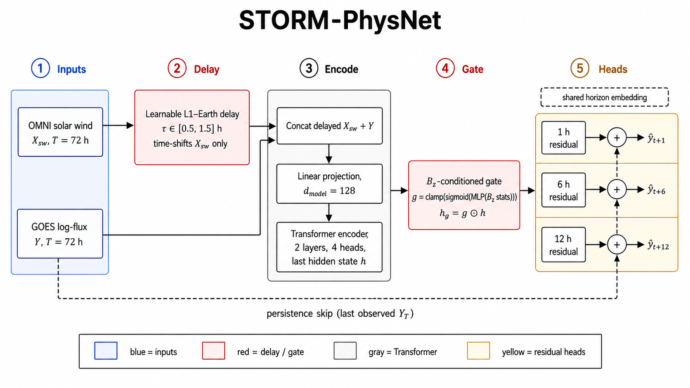
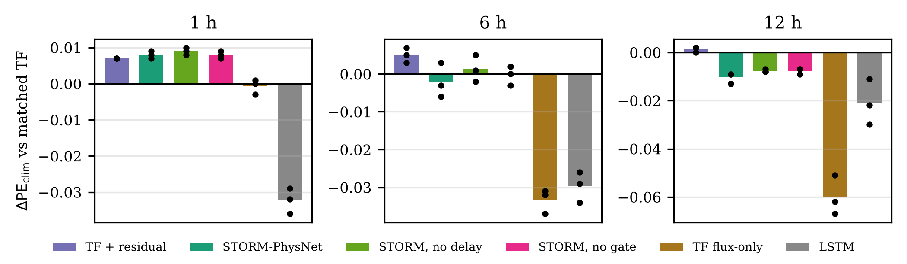

# STORM-PhysNet

Code, data, predictions and paper for:

**STORM-PhysNet: A Multi-Horizon Transformer for Geostationary Relativistic Electron Flux Forecasting and Cross-Satellite Transfer**
Samarth B N, Samrudh S Malali, Dhyan M, Sanjana H V. RV College of Engineering, Bangalore. IEEE AGERS 2026 (under review).

STORM-PhysNet forecasts GOES-15 >2 MeV electron log-flux at geostationary orbit 1, 6 and 12 h ahead. It works from a 72 h history of flux and OMNI solar-wind/geomagnetic drivers. On top of a Transformer encoder it adds:
- a learnable propagation delay
- a Bz-conditioned gate
- residual-over-persistence heads

It is also tested for transfer to the GRASP sensor on India's GSAT-19 (about 82°E).

<p align="center"></p>

## Results

PE is prediction efficiency against climatology. Each value is a seed mean (10 seeds), averaged over three disjoint test periods (2012–13, 2015–16, 2018–20), for 34,554 test windows in total.

| Model | Params | PE 1 h | PE 6 h | PE 12 h | PE vs persistence, 1 h |
|---|---:|---:|---:|---:|---:|
| Persistence | – | 0.968 | 0.581 | 0.261 | 0.00 |
| LSTM | 55 k | 0.937 | 0.838 | 0.792 | −0.97 |
| Transformer, architecture-matched | 1.19 M | 0.969 | 0.867 | 0.813 | 0.04 |
| Transformer + residual head | 268 k | 0.976 | **0.872** | **0.815** | 0.25 |
| Transformer, flux-only | 1.19 M | 0.968 | 0.834 | 0.753 | 0.01 |
| **STORM-PhysNet** | 344 k | 0.977 | 0.865 | 0.803 | 0.29 |
| STORM-PhysNet, no delay | 344 k | **0.978** | 0.869 | 0.806 | **0.32** |
| STORM-PhysNet, no gate | 344 k | 0.977 | 0.867 | 0.805 | 0.28 |

- **1 h.** STORM-PhysNet beats the matched Transformer in every test period (+0.008; paired p = 3.5e-18 over 30 seed–period pairs). The gain comes from the residual-over-persistence head.
- **6 h and 12 h.** The two are tied at 6 h (p = 0.14), and the matched Transformer leads at 12 h (−0.010). Solar-wind inputs add +0.034 and +0.060 PE at 6 and 12 h.
- **Robustness.** With unit-variance noise on the drivers, STORM-PhysNet keeps 1 h PE at 0.970; the matched Transformer drops to 0.892.
- **GSAT-19 GRASP transfer.** Zero-shot PE at 1 / 6 / 12 h:

  | Model | 1 h | 6 h | 12 h |
  |---|---:|---:|---:|
  | STORM-PhysNet | 0.961 | 0.827 | 0.738 |
  | Matched Transformer | 0.887 | 0.751 | 0.644 |

  After full fine-tuning both reach the same skill: 0.964 / 0.861 / 0.802 versus 0.964 / 0.857 / 0.794.

<p align="center"></p>

All tables are in [`results/`](results/): per-period results, bagged ensembles, gap-free subsets, paired tests, bootstrap intervals, storm-time errors, event skill, noise robustness and GRASP. Start with [`results/PAPER_NUMBERS.md`](results/PAPER_NUMBERS.md).

## Evaluation protocol

- **No future data in the inputs.**
  - Missing GOES hours are never filled from later observations. Inputs are forward-filled, and an observed-flux mask is an input channel.
  - A forecast is scored only if its last input hour and all three target hours are real observations.
  - Kp uses only the last completed 3-hour interval. There is no centred filtering.
- **Clean splits.** Every hour is labelled train, validation or test. A 72 + 12 h window is used only if all of its hours share one label.
- **Three test periods:**

  | Block | Test period | Test windows | Storm windows | Min Dst |
  |---|---|---:|---:|---:|
  | A | Sep 2018 – Mar 2020 | 7,536 | 18 | −69 nT |
  | B | 2015 – 2016 | 14,021 | 565 | −198 nT |
  | C | 2012 – 2013 | 12,997 | 354 | −139 nT |

  They share one validation period (Mar 2017 – Sep 2018), and each block trains on all remaining hours.
- **Statistics.** Seeds 42–51 for every model; paired t-tests with Cohen's d_z; 7-day block-bootstrap intervals for bagged models.
- **GRASP.** Data run from Jul 2017 to Aug 2018, in three chronological folds. The four regimes are zero-shot, heads-only fine-tuning, full fine-tuning and GRASP-only training.

## Repository layout

| Path | Contents |
|---|---|
| `paper/` | Manuscript (`STORM_PhysNet_AGERS2026_v2.tex` / `.pdf`), its figures, and the abstract |
| `results/` | All tables (`.csv` and `.tex`), figures, `numbers.json`, and `PAPER_NUMBERS.md` with automatic claim checks |
| `predictions/` | Every test prediction: 210 GOES runs (3 periods × 7 models × 10 seeds) and 10 GRASP seeds, with run logs and split metadata |
| `pipeline/` | Data pipeline, training (`train_block.py`), GRASP transfer (`grasp_transfer.py`), report builder (`combine_report.py`) and Kaggle notebooks. See [`pipeline/README.md`](pipeline/README.md). |
| `src/` | Model code (STORM-PhysNet, Transformer, LSTM), trainer and loss |
| `configs/config.yaml` | Training configuration |
| `datasets/` | GOES-15, OMNI and GRASP input files |
| `docs/literature/` | Annotated literature collection |

## Reproduce

Rebuild every table and figure from the saved predictions (CPU, about 1 minute):

```bash
pip install -r requirements.txt
cd predictions && for z in *.zip; do unzip -q "$z" -d "${z%.zip}"; done
python ../pipeline/combine_report.py --inputs preds_blockA_and_GRASP preds_blockB preds_blockC --out ../results_check
```

Retraining all models takes about 25 GPU-hours on a T4. Follow [`pipeline/README.md`](pipeline/README.md).

## Data sources

- GOES-15 EPEAD >2 MeV electrons: NOAA NCEI, https://www.ngdc.noaa.gov/stp/satellite/goes/
- OMNI hourly solar wind and indices: NASA OMNIWeb, https://omniweb.gsfc.nasa.gov/
- GSAT-19 GRASP: ISSDC PRADAN, https://pradan1.issdc.gov.in/grasp/

Follow each provider's terms of use.

## Citation

```bibtex
@inproceedings{samarth2026stormphysnet,
  title     = {STORM-PhysNet: A Multi-Horizon Transformer for Geostationary Relativistic Electron Flux Forecasting and Cross-Satellite Transfer},
  author    = {Samarth B N and Samrudh S Malali and Dhyan M and Sanjana H V},
  booktitle = {IEEE Asia-Pacific Conference on Geoscience, Electronics and Remote Sensing Technology (AGERS)},
  year      = {2026},
  note      = {Under review}
}
```

## License

MIT for code (see `LICENSE`).
